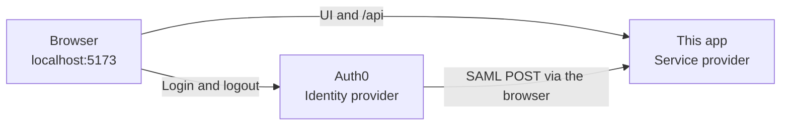
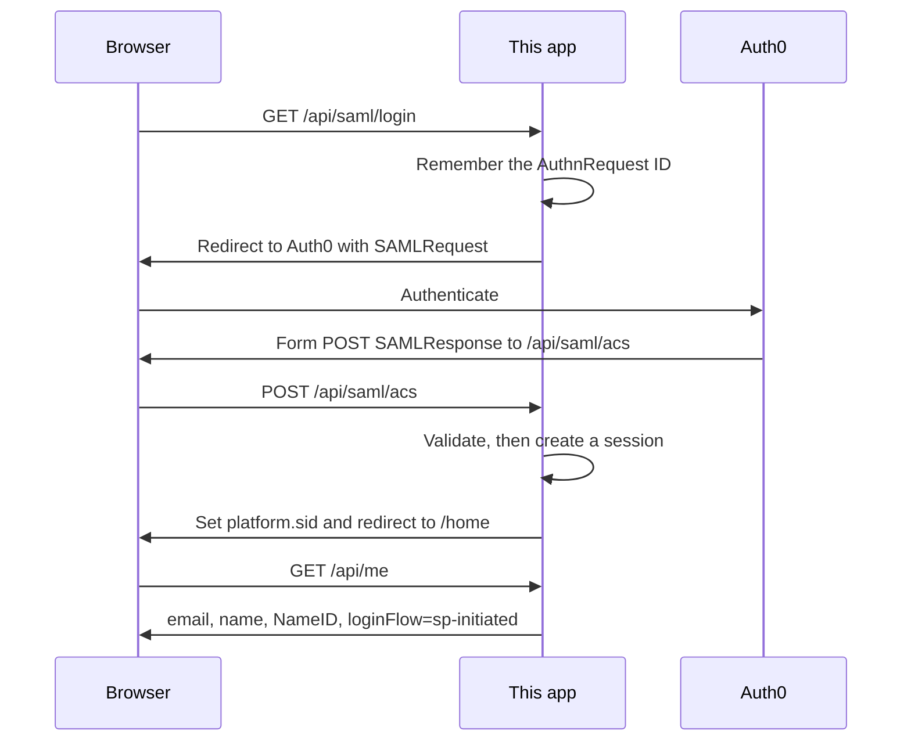
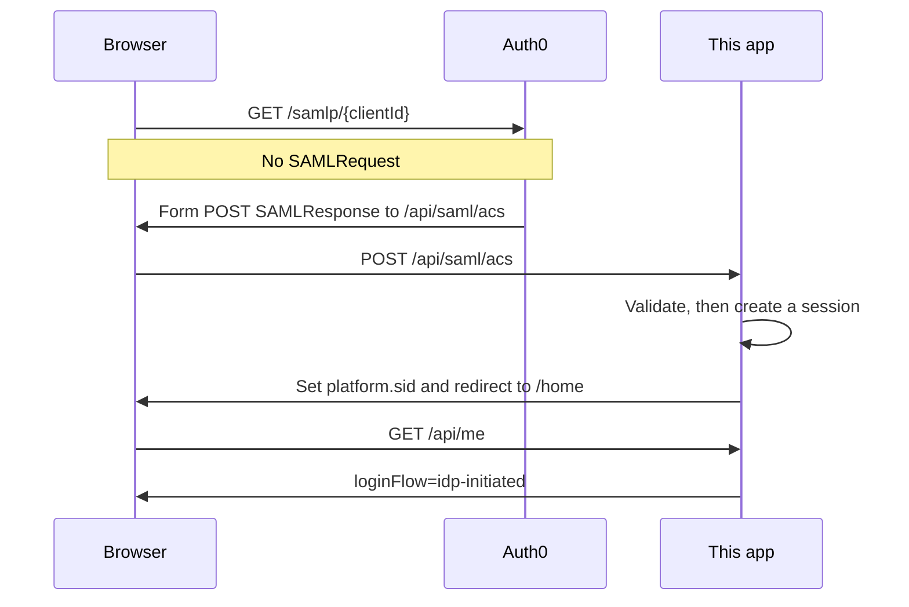
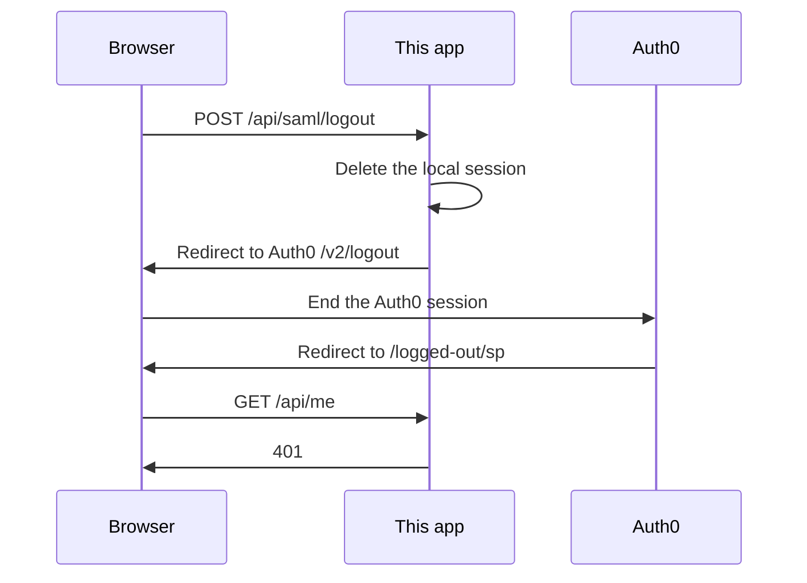
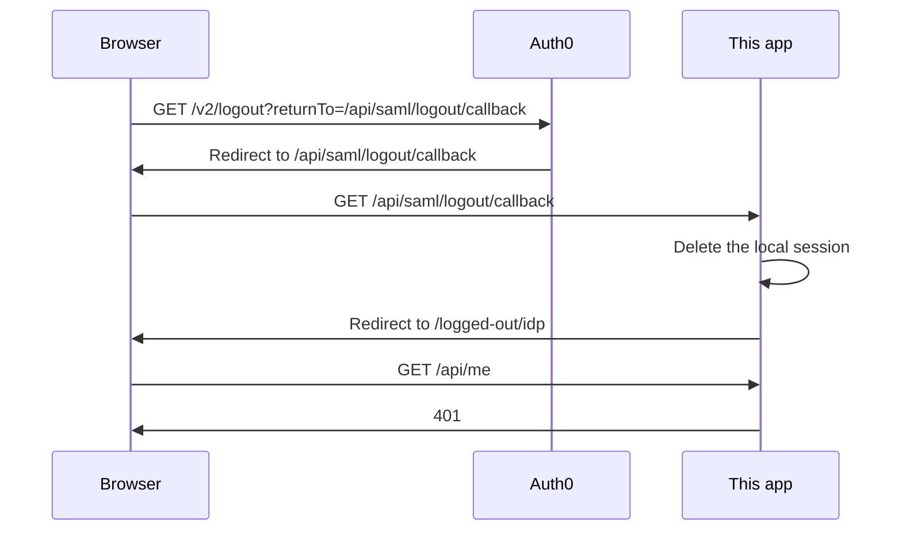
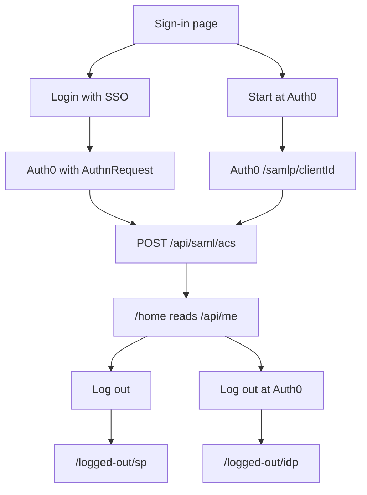

# Architecture

Auth0 is the SAML identity provider. This app is the service provider. The browser can start at either one. Both paths end at the same assertion consumer, and the signed-in page says which path created the session.

The API process listens on port 4000. Vite serves the UI on port 5173 and proxies `/api` to the API. Auth0 posts the assertion to `http://localhost:5173/api/saml/acs`, so the session cookie is set on the same origin as the UI. Open the demo at port 5173. Port 4000 only confirms the API is up.

## Pieces

| Piece | Responsibility |
| --- | --- |
| `frontend` | Two labeled login cards and two labeled logout cards. It does not parse SAML. |
| `backend/src/saml` | IdP metadata, AuthnRequest, ACS, recipient check, assertion-ID replay cache. |
| `backend/src/auth` | Signed `platform.sid` cookie and the in-memory session store. |
| `backend/src/routes` | `GET /api/me` and the Auth0 URLs the UI displays. |
| `@node-saml/node-saml` | Signature check, audience check, timestamps, and `InResponseTo`. |

## Endpoints

| Method and path | Who calls it | What it does |
| --- | --- | --- |
| `GET /api/saml/login` | SP-initiated button | Redirects to Auth0 with a SAML `AuthnRequest`. |
| `GET https://{domain}/samlp/{clientId}` | IdP-initiated button | Auth0 login with no `AuthnRequest`. |
| `POST /api/saml/acs` | Auth0, through the browser | Validates the assertion and issues the session. |
| `GET /api/me` | Signed-in page | Returns the identity, or 401. |
| `GET /api/saml/metadata` | A reviewer, or a future IdP | Service-provider descriptor. |
| `POST /api/saml/logout` | SP-initiated logout button | Deletes the local session, then redirects to Auth0 `/v2/logout`. |
| `GET /api/saml/logout/callback` | Auth0, after IdP logout | Deletes the local session, then shows `/logged-out/idp`. |
| `POST /api/saml/slo` | Auth0, only if SAML SLO is turned on | Accepts a signed logout message. The demo buttons do not call this. |

## SP-initiated login

The user starts on this app. The assertion later contains `InResponseTo`, so the session is labeled **SP-initiated login**.

1. **Login with SSO** navigates to `/api/saml/login`.
2. The service provider builds an `AuthnRequest` and redirects the browser to Auth0.
3. Auth0 authenticates the user and posts a signed assertion to `/api/saml/acs`.
4. The ACS checks the assertion, stores a session, and redirects to `/home`.
5. `/home` reads `/api/me`. The label is **SP-initiated login** because `InResponseTo` was present.

## IdP-initiated login

The user starts at Auth0. There is no `AuthnRequest` and no `InResponseTo`. The session is labeled **IdP-initiated login**.

Open this URL while `npm run dev` is running:

`https://{domain}/samlp/{clientId}`

For this tenant that is:

`https://dev-narayanamurthy.us.auth0.com/samlp/pMf2UHwbQboi6qPr6qAn9bKelVTsjWzN`

The same URL is the **Start at Auth0** button, and it is listed in the Auth0 addon under **Usage → Identity Provider Login URL**.

Auth0 cannot open the app by itself. The callback is `localhost`, so the API must already be running on the reviewer's machine.

## What the ACS checks

Both flows use `POST /api/saml/acs`. A session is created only if every check passes. The browser is then sent to `/home`. `RelayState` is not used as a redirect URL.

| Order | Check | Owner |
| --- | --- | --- |
| 1 | Assertion signature, using the cert from Auth0 metadata | node-saml |
| 2 | Audience is `urn:platform:sp` | node-saml |
| 3 | Timestamps, with 2 minutes of clock skew and a 10 minute maximum age | node-saml |
| 4 | If `InResponseTo` is present, it must match an `AuthnRequest` this process issued, and it is consumed | node-saml |
| 5 | Assertion `ID` has not been accepted before | `ReplayCache` |
| 6 | Issuer matches the Auth0 metadata `entityID` | `acceptAssertion` |
| 7 | `Recipient` is exactly the ACS URL | `acceptAssertion` |

`InResponseTo` distinguishes the flows. Its presence means this app started the login. Its absence means Auth0 started the login. IdP-initiated responses have no `InResponseTo`, so the assertion `ID` is what stops those responses from being posted twice.

The cookie stores a random session id. The identity lives in memory on the API process: email, name, `NameID`, assertion id, and `loginFlow`. Restarting the API drops every session. The record lasts 8 hours or until logout.

`NameID` is the Auth0 user id (`auth0|...`). Email is display only.

## SP-initiated logout

The user clicks **Log out** on `/home`.

The page **SP-initiated logout** reports that the local session is gone. The next login asks for a password again.

## IdP-initiated logout

The user clicks **Log out at Auth0**. The first request does not hit this app.

The page **IdP-initiated logout** is the proof that logout started at Auth0 and this app cleared its session on the way back.

These two buttons use Auth0 `/v2/logout`. They do not send a signed SAML `LogoutRequest`. `POST /api/saml/slo` is ready for that message if the addon later has `slo_enabled` set to true. A logout request that fails signature validation does not delete sessions. Logging out only in the Auth0 dashboard, with no return to this app, leaves the local session in place until it expires.

## Request map

