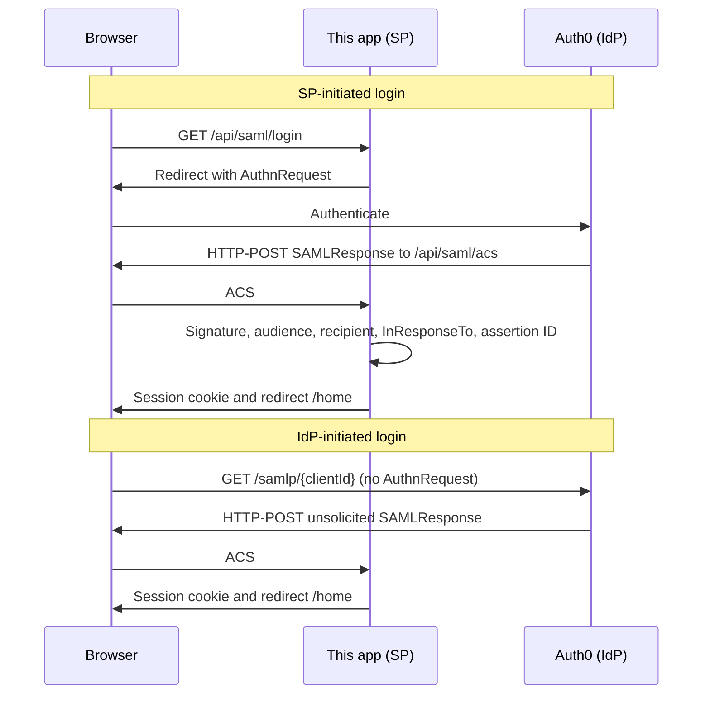

# Platform SAML SSO

Auth0 is the SAML identity provider. This repository is the service provider: a Node.js API that validates assertions, plus a small React UI that can start login from either side.

The browser origin is `http://localhost:5173`. The API listens on port `4000`. Vite proxies `/api` to the API, so the session cookie, the ACS URL, and the UI share one origin.

## What you need to do

You need a free Auth0 dev tenant and a fake test user. Do not use a production tenant or a real person's data. The app cannot create the tenant for you.

### 1. Install and check Node

Node.js 20 or newer. From the repo root:

```bash
node -v
npm install
npm install --prefix backend
npm install --prefix frontend
npm test
```

`npm test` does not call Auth0. It checks replay protection, recipient and issuer rejection, both login-flow labels, and that a logout request with a bad signature does not delete the session.

### 2. Create the Auth0 tenant and a user

1. Sign up at [https://auth0.com](https://auth0.com) and create a development tenant. Copy the domain, for example `dev-abc123.us.auth0.com`. That host, with no `https://`, is `AUTH0_DOMAIN`.
2. Go to **Authentication → Database → Username-Password-Authentication**.
3. Open the **Users** tab (or **User Management → Users**) and create a user with a fake email such as `demo.user@example.com` and a password you can share with the reviewer.
4. Open that user and mark the email as verified if Auth0 did not do it for you. Unverified database users are a common reason a correct password still fails.

### 3. Create the application that acts as the IdP

This is the step that is easy to get backwards. Do **not** create an Enterprise SAML connection. That screen makes Auth0 the service provider. This assignment needs the opposite.

1. **Applications → Applications → Create Application**.
2. Name it `Platform SP`. Choose **Regular Web Application**.
3. On **Settings**:
   - Allowed Callback URLs: `http://localhost:5173/api/saml/acs`
   - Allowed Logout URLs: `http://localhost:5173/logged-out/sp`, `http://localhost:5173/api/saml/logout/callback`
   - Allowed Web Origins: `http://localhost:5173`
   - Save.
4. Copy the **Client ID**. You do not need the client secret. This app does not use one.
5. Open the **Connections** tab and leave **Username-Password-Authentication** enabled.
6. Open the **Addons** tab. Turn on **SAML2 Web App**.
7. Set **Application Callback URL** to `http://localhost:5173/api/saml/acs`.
8. Replace the Settings JSON with the contents of [`auth0/saml-addon-settings.json`](auth0/saml-addon-settings.json). Do not turn on `signResponse`. Auth0 would then sign the response instead of the assertion, and this service provider rejects that.
9. Save. If Auth0 offers a Debug button, use it only after the API is running.
10. Open the addon **Usage** tab and confirm the Identity Provider Login URL looks like `https://YOUR_DOMAIN/samlp/YOUR_CLIENT_ID`.

`audience` in that JSON is `urn:platform:sp`. IdP-initiated login has no AuthnRequest to copy an audience from, so this value has to be set. It must match `SP_ENTITY_ID`.

### 4. Configure `.env`

```bash
copy .env.example .env
```

On macOS or Linux, use `cp` instead of `copy`.

Fill in:

| Variable | Value |
| --- | --- |
| `AUTH0_DOMAIN` | Tenant host only, such as `dev-abc123.us.auth0.com` |
| `AUTH0_CLIENT_ID` | Client ID from step 3 |
| `APP_BASE_URL` | `http://localhost:5173` |
| `SESSION_SECRET` | Output of `node -e "console.log(require('crypto').randomBytes(32).toString('hex'))"` |
| `SP_ENTITY_ID` | `urn:platform:sp` |

Leave `SAML_IDP_CERT` unset. On startup the API downloads `https://{domain}/samlp/metadata/{clientId}` and uses the signing certificate from it.

### 5. Run the demo

From the repo root:

```bash
npm run dev
```

Open **[http://localhost:5173](http://localhost:5173)**. Do not use port 4000 for the demo. Port 4000 is the API. If you open it, it only tells you to go back to 5173.

The API log prints the ACS URL and the entity ID. Those two strings must match Auth0.

Restart the API after any `.env` change. `--watch` does not reload `.env`.

## How to trigger each flow

### SP-initiated login

1. Open [http://localhost:5173](http://localhost:5173).
2. In the card labeled **SP-initiated login**, click **Login with SSO**.
3. Sign in as the fake Auth0 user.
4. You land on `/home`. The page says **SP-initiated login** and **Logged in as: {email}**. That label comes from the server session, because the assertion contained `InResponseTo`.

The button goes to `/api/saml/login`, which redirects to Auth0 with a SAML `AuthnRequest`.

### IdP-initiated login

Log out first if you still have an Auth0 session, or you will not see the password form. Auth0 will still post a new assertion.

1. On the sign-in page, in the card labeled **IdP-initiated login**, click **Start at Auth0**.
2. That link is `https://{domain}/samlp/{clientId}` with no `SAMLRequest`.
3. Sign in.
4. You land on `/home` and the page says **IdP-initiated login**.

You can also paste that same URL into a fresh browser tab. You never have to visit the sign-in page first. That is the point of this flow.

### SP-initiated logout

On `/home`, in the card labeled **SP-initiated logout**, click **Log out**.

The app deletes its session, then sends you to Auth0 `/v2/logout`, then to `/logged-out/sp`. The page asks `/api/me` and should say the local session is gone. The next login should prompt for a password.

### IdP-initiated logout

On `/home`, in the card labeled **IdP-initiated logout**, click **Log out at Auth0**.

That link opens Auth0 first. It does not post to this app's logout route. Auth0 then redirects to `/api/saml/logout/callback`, which deletes the local session and sends you to `/logged-out/idp`.

This uses Auth0's logout endpoint plus a return URL. It is not a signed SAML `LogoutRequest`. The gap is described in `DECISIONS.md`. Logging out only in the Auth0 dashboard, with no return to this app, leaves the local session in place until it expires (8 hours) or you hit one of these logout paths.

## Tenant access for the reviewer

Dev tenant and test user for the review. The client secret is unused.

| | |
| --- | --- |
| Domain | `dev-narayanamurthy.us.auth0.com` |
| Application | Platform SP |
| Client ID | `pMf2UHwbQboi6qPr6qAn9bKelVTsjWzN` |
| Test user | `knmurthy514@gmail.com` |
| Password | `NarayanaMurthy@123#` |
| Walkthrough | |

## Architecture



| Piece | Role |
| --- | --- |
| `backend/src/saml` | IdP metadata, node-saml options, ACS, recipient and replay checks |
| `backend/src/auth` | Signed session cookie and in-memory sessions, indexed by NameID |
| `backend/src/routes` | `/api/me` and the demo links the UI needs |
| `frontend` | Two labeled entry points for login, and two for logout |

`/api/me` returns the identity taken from the assertion. It is `401` when there is no session.

`/api/saml/metadata` is the service-provider metadata. Auth0's addon does not import it; the settings JSON is the configuration that matters. The endpoint is there so the SP descriptor can be inspected, and so a future IdP that does import metadata has a URL.

## Attribute mapping

Configured in the addon settings:

| Auth0 profile field | Assertion attribute | Used for |
| --- | --- | --- |
| `user_id` via the nameidentifier probe | `NameID` | Stable subject key |
| `email` | `.../claims/emailaddress` | "Logged in as" |
| `name` | `.../claims/name` | Display |

`NameID` is the Auth0 user id (`auth0|...`), not the email. Email can change. The format is `unspecified`, which is what Auth0 emits for that id.

## Troubleshooting

| What you see | What to change |
| --- | --- |
| API exits on startup about metadata | Domain or client id is wrong, or the SAML addon is not enabled. |
| Callback URL mismatch at Auth0 | Allowed Callback URLs and the addon Application Callback URL must both be `http://localhost:5173/api/saml/acs`. |
| Audience error on the sign-in page | Addon `audience` must be `urn:platform:sp`. |
| Signature error | Leave `signResponse` false. Restart the API so it re-reads the cert. |
| `InResponseTo` error | The SP-initiated attempt was reused or the API restarted mid-login. Click **Login with SSO** again. |
| Replay error | The same assertion POST was submitted twice. Start a new login. |
| Password works but Auth0 will not continue | Mark the user's email verified. Confirm the database connection is enabled on the application. |
| Signed-in page says not signed in | You opened port 4000, or Auth0's ACS URL is not `http://localhost:5173/api/saml/acs`. |
| Logout returns to Auth0 with an error about `returnTo` | Allowed Logout URLs must include both URLs from step 3. |

## Layout

```
backend/src/saml     SP config, metadata, ACS, logout
backend/src/auth     session cookie and store
backend/src/routes   current-user and demo links
frontend             React demo of both flows
auth0                JSON to paste into the SAML addon
DECISIONS.md         assumptions, tradeoffs, logout, AI use
```
